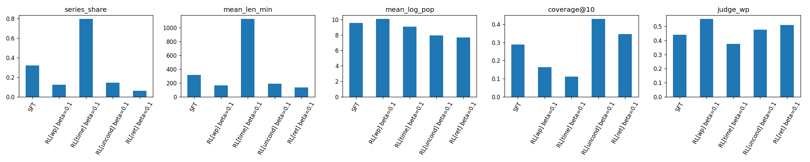
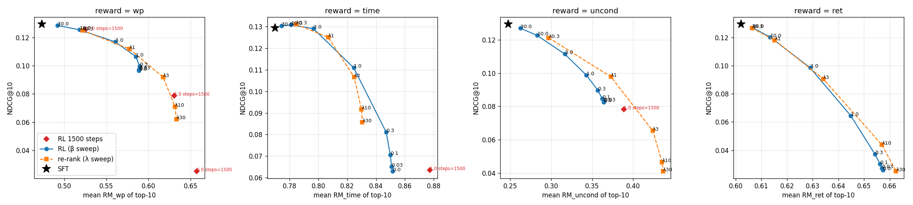
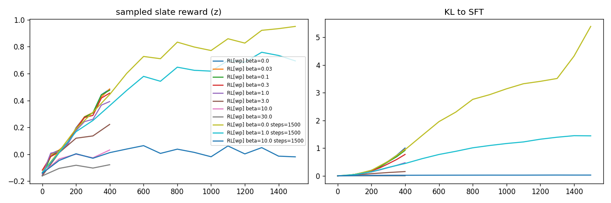
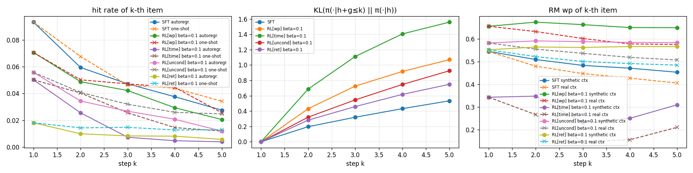

# RL-дообучение генеративной рекомендательной модели: награда, релевантность и reward hacking на данных KION

## Аннотация

Исследуется, как дообучение последовательной рекомендательной модели с подкреплением (RL) по выученной модели вознаграждения меняет её поведение и качество рекомендаций. Объекты исследования:
- базовая модель GPT-2, обученная предсказывать следующий объект (next item prediction) на данных онлайн-кинотеатра KION [3];
- модели вознаграждения для доли досмотра, времени просмотра, «безусловной» вовлечённости и возврата пользователя;
- RL-дообучение методом policy gradient (RLOO) по спискам Плакетта–Льюса с точным KL-штрафом к базовой модели.

Основные результаты:
- Оптимизация любой из наград успешно повышает предсказанное вознаграждение, но при слабом KL-штрафе снижает релевантность и вызывает характерные для каждой награды сдвиги каталога.
- Без регуляризации длительное обучение приводит к коллапсу: половина пользователей получает один и тот же первый объект. При этом и обучающая, и независимая модель вознаграждения показывают максимум, то есть взламывается сама метрика.
- При поточечной награде RL и переранжирование кандидатов по `log π + λ·r` лежат на одном фронте Парето, что согласуется с замкнутым видом KL-оптимальной политики.
- При многошаговой генерации модель вознаграждения систематически завышает оценку на синтетическом контексте.

## 1. Постановка

Последовательная модель, обученная предсказывать следующий объект, оптимизирует краткосрочную цель — вероятность взаимодействия. Задача — проверить, можно ли с помощью RL направить её генерацию к объектам с более высоким ожидаемым откликом (долей досмотра, временем просмотра, возвратом пользователя) и какой ценой.

Исследовательские вопросы:

1. **В1.** Как меняется поведение модели после RL-дообучения? Удаётся ли максимизировать награду, чем рекомендации отличаются от исходных и почему?
2. **В2.** Сохраняется ли релевантность (Recall, NDCG, MAP@K)? Не начинает ли модель рекомендовать всем одно и то же?
3. **В3.** Можно ли приблизиться к долгосрочным целям? Какие сигналы для этого есть в данных, что проверяется офлайн, а что только онлайн?
4. **В4.** Что происходит при генерации нескольких шагов вперёд, когда сгенерированные объекты добавляются в контекст?
5. **В5.** Каков компромисс между релевантностью и вознаграждением и как на него влияют функция награды и настройки RL?

## 2. Данные и протокол

### 2.1 Датасет

MTS KION [3]: 5.48 млн взаимодействий, 962 тыс. пользователей, 15.7 тыс. объектов (фильмы и сериалы), 2021-03-13 … 2021-08-22. Для каждого взаимодействия известны дата, `total_dur` (секунды просмотра) и `watched_pct` (доля досмотра).

Почему KION:
- каталог целиком помещается в словарь GPT-2;
- два сигнала отклика тянут в разные стороны: медианная доля досмотра у сериалов 13%, у фильмов 45%, зато сериалы дают больше времени просмотра;
- метаданные (тип, жанры, возрастной рейтинг) позволяют интерпретировать сдвиги поведения.

> Файл `interactions.csv.zip` в корне репозитория KION **обрезан**: ровно 50 МиБ, 1.59 млн строк из 5.48 млн, последняя строка оборвана. Полные данные находятся в `data_original.zip`, и пайплайн читает их оттуда.

Особенности данных, повлиявшие на протокол:
- одна строка на пару (пользователь, объект): повторных просмотров в данных нет, `last_watch_dt` дан с точностью до дня;
- 55% взаимодействий приходятся на один день с другим взаимодействием того же пользователя. Порядок внутри дня неизвестен (фиксированный случайный порядок), поэтому качество оценивается по **множеству объектов следующей недели**, как в соревновании KION с метрикой MAP@10;
- истории короткие: медиана 2 взаимодействия, среднее 5.7;
- `watched_pct` бимодален: 26% строк равны 100, ещё около 26% меньше 5.

### 2.2 Разбиение и правила оценки

Глобальное разбиение по времени:

| часть | период | назначение |
|---|---|---|
| train | < 2021-08-09 | базовая модель, обучающая модель вознаграждения RM-A, состояния для RL |
| val | 2021-08-09 … 08-15 | ранняя остановка базовой модели, обучение независимой модели RM-B, нормировка наград |
| test | 2021-08-16 … 08-22 | итоговая оценка всех моделей; история — всё до 08-16 |

Правила:
- **Словарь:** объекты с ≥ 10 взаимодействиями в train (8 019 объектов). Тестовые объекты вне словаря считаются промахами.
- **Статистики объектов** (популярность, средний досмотр, оценка длительности как `total_dur / watched_pct`) считаются только по train.
- **Оцениваемые пользователи:** ≥ 2 взаимодействия в истории и ≥ 1 в целевой неделе. Фиксированная выборка из 20 000 пользователей, одинаковая для всех моделей. Уже просмотренные объекты из рекомендаций исключаются.

### 2.3 Метрики

- **Релевантность:** Recall@10, NDCG@10, MAP@10, HitRate@10. Дополнительно **gNDCG@10** — NDCG с градуированной релевантностью, где выигрыш попадания равен его фактическому `watched_pct`. Это офлайн-метрика вовлечённости, не зависящая от модели вознаграждения.
- **Разнообразие и коллапс:** coverage@10, индекс Джини, доля пользователей с одинаковым первым объектом (top1_share), средний коэффициент Жаккара между списками разных пользователей, доля доминирующего жанра в списке.
- **Поведение:** доля сериалов и детского контента, средняя длительность, средняя log-популярность, доля уже просмотренного.
- **Награда:** средние предсказания головок RM-A по top-10 и предсказание независимой модели RM-B (judge_wp).

## 3. Методы

### 3.1 Базовая модель (SFT)

`transformers.GPT2LMHeadModel`: 2 слоя, d = 128, 4 головы внимания, контекст 64, общие входные и выходные эмбеддинги, dropout 0.2. Токены — идентификаторы объектов и служебные PAD/SEP. Обучение: кросс-энтропия следующего объекта на всех позициях (полный softmax по словарю), ранняя остановка по NDCG@10 на val.

Рекомендации строятся двумя способами:
- **Top-K** — один проход;
- **Next-K** — авторегрессия: каждый сгенерированный объект добавляется в контекст.

Бейзлайн — популярность за последние 14 дней.

### 3.2 Модели вознаграждения

**RM-A (используется для обучения).** Каузальный трансформер, инициализированный весами SFT, кодирует историю в состояние пользователя. Многослойный перцептрон принимает состояние, эмбеддинг объекта, их поэлементное произведение и признаки объекта. Головки:

| головка | что предсказывает | на чём обучается |
|---|---|---|
| `wp` | E[watched_pct / 100 \| пользователь начал смотреть] | наблюдаемые пары, BCE |
| `complete` | P(watched_pct ≥ 80) | наблюдаемые пары |
| `time` | E[log1p(total_dur)] | наблюдаемые пары, MSE |
| `uncond` | E[watched_pct · 1{смотрел}] | наблюдаемые пары и 4 негатива, сэмплированных пропорционально популярности, с целевым значением 0; «безусловная» вовлечённость, включающая вероятность начать просмотр |
| `ret` | P(возврат в течение 7 дней \| посмотрел) | строки, 7-дневное окно которых целиком внутри train |

**RM-B (независимая модель, «судья»).** CatBoost на признаках пользователя и объекта (статистики, жанровая близость), обученный на других данных — парах из val. В RL не используется. Расхождение RM-A и RM-B служит индикатором эксплуатации ошибок обучающей модели вознаграждения.

### 3.3 RL-дообучение

**Постановка.** Состояние — реальная история пользователя. Действие — упорядоченный список из K = 10 объектов, сэмплированный без возвращения из π_θ(·|h) за один проход (Gumbel-top-k). Вероятность списка задаётся моделью Плакетта–Льюса, поэтому градиент проходит через ту же GPT-2.

**Награда списка:** R = Σᵢ wᵢ · z(r(h, gᵢ)), где wᵢ ∝ 1/log₂(i+1), r — одна из головок RM-A, z — нормировка по статистикам рекомендаций SFT, чтобы коэффициент β был сопоставим между наградами.

**Алгоритм.** Policy gradient с групповым бейзлайном (RLOO): на пользователя сэмплируется G = 4 списка, бейзлайн — среднее награды остальных списков группы. Добавляется точный KL(π_θ ‖ π_SFT) по распределению следующего объекта:

`L = −E[A · log π_θ(список)] + β · KL`

При словаре около 8 тыс. объектов KL вычисляется точно, а не оценивается по выборке. Критик не используется: горизонт одношаговый. Настройки: 400 шагов по 256 пользователей, AdamW с lr = 3·10⁻⁵.

**Сетка экспериментов:**
- награды {`wp`, `time`, `uncond`, `ret`} × β ∈ {0, 0.03, 0.1, 0.3, 1, 3, 10, 30};
- прогоны на 1 500 шагов для части конфигураций;
- абляции: без маскирования просмотренного (`wp`) и с наградой за весь список (`uncond` + внутрисписочное жанровое расстояние, награда не раскладывается по объектам).

**Контрольный эксперимент — переранжирование.** 100 лучших кандидатов SFT упорядочиваются по `log π_SFT(i|h) + λ · z(r(h,i))`. Для KL-регуляризованной цели с поточечной наградой оптимальная политика имеет вид π* ∝ π_SFT · exp(r/β), то есть совпадает с таким переранжированием при λ = 1/β. Отсюда гипотеза: **при поточечной награде RL может в лучшем случае достичь фронта переранжирования**, а преимущество возможно только на наградах за список целиком или многошаговых.

### 3.4 Многошаговая генерация

Для 5 000 тестовых пользователей жадно генерируются 5 объектов, каждый добавляется в контекст как просмотренный. На каждом шаге k измеряются:
- попадание k-го объекта в реальную тестовую неделю (в сравнении с k-м объектом одношагового Top-K);
- KL(π(·|h+g₁..gₖ) ‖ π(·|h)) — отклонение распределения от построенного по реальной истории;
- оценка RM-A для k-го объекта при синтетическом и при реальном контексте;
- концентрация жанров.

## 4. Результаты

Все числа — тестовая неделя 2021-08-16 … 22, одни и те же 20 000 пользователей. RM_* — средняя оценка соответствующей головки RM-A по top-10, judge_wp — оценка RM-B. Полные таблицы всех конфигураций — в [`results/tables.md`](results/tables.md).

### 4.1 Базовые модели

| модель | Recall@10 | NDCG@10 | MAP@10 | gNDCG@10 | coverage | доля сериалов | judge_wp |
|---|---|---|---|---|---|---|---|
| популярность (14 дней) | 0.172 | 0.113 | 0.075 | 0.099 | 0.003 | 0.51 | 0.376 |
| **SFT GPT-2, Top-K** | **0.186** | **0.129** | **0.089** | **0.119** | 0.289 | 0.32 | 0.441 |
| SFT, Next-K | 0.174 | 0.124 | 0.086 | 0.112 | 0.230 | 0.37 | 0.425 |
| SFT без маски просмотренного | 0.171 | 0.117 | 0.080 | 0.109 | 0.287 | 0.32 | 0.441 |

- GPT-2 превосходит популярность по всем метрикам релевантности.
- Next-K уступает Top-K той же модели, что согласуется с [1] для моделей, обученных на сдвиге последовательности.
- Без маски 16% рекомендаций — уже просмотренные объекты. В KION повторный просмотр в данных не наблюдается никогда, поэтому такие рекомендации бесполезны.

### 4.2 Модели вознаграждения

Пары тестовой недели:

| модель | MAE watched_pct | AUC досмотра (≥ 80%) | Спирмен внутри пользователя |
|---|---|---|---|
| глобальное среднее | 0.369 | 0.50 | — |
| среднее по объекту (train) | 0.331 | 0.67 | 0.244 |
| среднее по пользователю | 0.335 | 0.66 | — |
| **RM-A (нейросеть)** | 0.316 | 0.70 | **0.270** |
| **RM-B (CatBoost)** | **0.304** | **0.75** | 0.258 |

Остальные головки RM-A:

| головка | проверка | AUC |
|---|---|---|
| `uncond` | просмотренные в тестовую неделю объекты против негативов по популярности | 0.75 |
| `wp` (условная) | та же задача | 0.57 |
| `ret` | возврат в течение 7 дней | 0.58 (доля возвратов 0.69) |

Обе модели превосходят простые бейзлайны, но точность умеренная. Условная головка `wp` почти не отличает объекты, которые пользователь посмотрел, от случайных популярных. Она предсказывает, *сколько* пользователь досмотрит, если начнёт, но не *начнёт ли*: это следствие смещения отбора. Долгосрочный сигнал (`ret`) в KION предсказывается плохо.

### 4.3 Поведение после RL (В1, В2)

Конфигурации: β = 0.1, 400 шагов.

| | NDCG@10 | gNDCG@10 | coverage | top1_share | Жаккар между пользователями | сериалы | длит., мин | log-попул. | RM своей награды | judge_wp |
|---|---|---|---|---|---|---|---|---|---|---|
| SFT | 0.129 | 0.119 | 0.29 | 0.17 | 0.12 | 0.32 | 315 | 9.5 | — | 0.441 |
| RL[`wp`] | 0.097 | 0.096 | 0.16 | 0.31 | 0.27 | **0.12** | **166** | 10.1 | 0.47 → **0.59** | **0.552** |
| RL[`time`] | 0.071 | 0.064 | 0.11 | **0.46** | **0.45** | **0.79** | **1123** | 9.1 | 0.77 → 0.85 | 0.376 |
| RL[`uncond`] | 0.085 | 0.081 | **0.43** | 0.07 | **0.04** | 0.15 | 189 | **7.9** | 0.25 → 0.36 | 0.477 |
| RL[`ret`] | **0.030** | 0.029 | 0.35 | 0.14 | 0.07 | 0.06 | 136 | 7.7 | 0.60 → 0.66 | 0.509 |



Награда максимизируется во всех случаях. Сдвиги поведения объясняются так:

1. **Доля досмотра (`wp`).**
   - Модель уходит от сериалов (32% → 12%) к коротким популярным фильмам, покрытие каталога падает вдвое, top1_share растёт до 0.31.
   - Независимая модель также фиксирует рост досмотра (0.44 → 0.55): это не ошибка конкретной модели вознаграждения, а **свойство самой метрики**, ведь у сериала `watched_pct` низкий по построению.
   - Награда оптимизируется корректно, но плохо отражает удовлетворённость: NDCG −25%, gNDCG −20%.
2. **Время просмотра (`time`).**
   - Зеркальный эффект: 79% сериалов, средняя длительность 1 123 мин и коллапс. top1_share 0.46, коэффициент Жаккара между пользователями вырос с 0.12 до 0.45.
   - Независимая оценка досмотра падает.
   - Две правдоподобные краткосрочные награды сдвигают каталог в противоположные стороны.
3. **Безусловная вовлечённость (`uncond`).**
   - Обратный коллапсу эффект: покрытие 0.43, списки разных пользователей почти не пересекаются, средняя популярность резко падает.
   - Причина — негативы при обучении головки сэмплировались пропорционально популярности. Головка выучила величину, близкую к поточечной взаимной информации, в которой популярность объекта работает как штраф. RL эксплуатирует это смещение и уходит в нишевый контент.
4. **Возврат (`ret`).** Самая слабая головка (AUC 0.58) и самое сильное падение релевантности: NDCG ниже в 4.3 раза при росте предсказанной награды. Это проявление закона Гудхарта: оптимизатор находит объекты, на которых слабая модель ошибается в сторону завышения.
5. **Абляции.**
   - Без маски просмотренного RL[`wp`] рекомендует уже просмотренное в 15.7% случаев — примерно столько же, сколько SFT без маски (16%). Повторы не стали каналом эксплуатации.
   - Награда за жанровое разнообразие списка немного улучшает и разнообразие, и релевантность: доля доминирующего жанра 0.31 → 0.30, NDCG 0.085 → 0.088. Эффект мал.

Индикатор эксплуатации — расхождение RM-A и RM-B:
- для `wp` модели согласны, но релевантность всё равно падает;
- для `time` RM-B не подтверждает улучшения;
- для `ret` RM-A растёт, а релевантность разрушена.

### 4.4 Компромисс релевантность ↔ награда (В5)





**При β ≤ 0.1 метрики почти не меняются.** KL-градиент мал по сравнению с нормированным градиентом политики, и в этом режиме отклонение ограничивает **бюджет обучения**: за 400 шагов награда и KL ещё растут. Это неявная регуляризация, аналогичная ранней остановке. Поэтому сетка расширена до β ∈ {3, 10, 30} и прогонов на 1 500 шагов:

| конфигурация | NDCG@10 | gNDCG@10 | coverage | top1_share | сериалы | RM своей награды | judge_wp | KL в конце |
|---|---|---|---|---|---|---|---|---|
| SFT | 0.129 | 0.119 | 0.29 | 0.17 | 0.32 | — | 0.441 | 0 |
| RL[`time`] β = 10 | **0.131** | **0.121** | 0.27 | 0.19 | 0.34 | 0.770 → 0.781 | 0.450 | 0.02 |
| RL[`time`] β = 3 | 0.129 | 0.119 | 0.22 | 0.25 | 0.40 | 0.770 → 0.797 | 0.454 | 0.17 |
| RL[`wp`] β = 3 | 0.117 | 0.113 | 0.27 | 0.22 | 0.16 | 0.474 → 0.560 | 0.516 | 0.16 |
| RL[`wp`] β = 0, 1 500 шагов | **0.025** | 0.026 | **0.013** | **0.49** | 0.0003 | 0.474 → 0.658 | **0.621** | 5.4, растёт |
| RL[`wp`] β = 1, 1 500 шагов | 0.079 | 0.080 | 0.09 | 0.28 | 0.06 | → 0.631 | 0.582 | 1.45, плато |
| RL[`wp`] β = 10, 1 500 шагов | 0.125 | 0.119 | 0.29 | 0.19 | 0.23 | → 0.524 | 0.483 | 0.03, стабильно |
| RL[`time`] β = 1, 1 500 шагов | 0.064 | 0.057 | 0.05 | 0.38 | **0.95** | → 0.877 | 0.315 | 2.9, растёт |

Выводы:

- **β управляет компромиссом при достаточно длинном обучении.**
  - При β = 10 KL стабилизируется около 0.03, модель остаётся в окрестности SFT и за 1 500 шагов.
  - При β = 1 KL выходит на плато около 1.45.
  - При β = 0 KL растёт неограниченно.
- **Без KL — полный reward hacking.**
  - RL[`wp`] с β = 0 после 1 500 шагов отдаёт половине пользователей один и тот же первый объект и использует 1.3% каталога. Сериалов в выдаче не остаётся, NDCG падает в 5 раз.
  - При этом **и RM-A, и независимая RM-B показывают максимум** (0.62): модель нашла короткие фильмы, которые досматривают все.
  - Взломана не конкретная модель вознаграждения, а сама метрика доли досмотра. Обнаружить это можно только по метрикам релевантности и разнообразия.
- **Небольшой рост награды без потери точности возможен.**
  - RL[`time`] с β = 3–10 сохраняет NDCG на уровне SFT (0.129–0.131, gNDCG 0.119–0.121) и повышает предсказанное время просмотра.
  - Переранжирование с λ = 0.3 даёт ту же картину: для `time` NDCG 0.131; для `wp` NDCG −3% при +10% предсказанного досмотра, RM-B +9%, доля сериалов 32% → 24%.
  - Различия порядка 0.002 NDCG находятся на уровне шума, поэтому корректная формулировка — «награда выросла без потери точности».
- **RL и переранжирование лежат на одном фронте Парето.**
  - Это эмпирически подтверждает, что при поточечной награде KL-регуляризованный RL приближает π_SFT · exp(r/β).
  - RL может выйти за пределы 100 кандидатов SFT: длинный RL[`wp`] достигает RM 0.658 против максимума 0.634 у переранжирования. Но именно эта область и есть область взлома.
  - Практические преимущества RL — отсутствие модели вознаграждения на этапе вывода и возможность оптимизировать награды, не раскладывающиеся по объектам.

### 4.5 Генерация на несколько шагов вперёд (В4)



1. **Точность падает быстрее, чем у одношагового Top-K той же модели.** Попадание k-го объекта в реальную неделю:
   - у SFT на 5-м шаге 0.028 против 0.034 у 5-й позиции Top-K;
   - у RL[`time`] 0.004 против 0.012.

   Сгенерированная рекомендация не является фактом просмотра, и модель продолжает вымышленную историю.
2. **Распределение отклоняется от реальной истории.** KL(π(·|h+g₁..gₖ) ‖ π(·|h)) растёт почти линейно: у SFT 0.53 к 5-му шагу, у RL-моделей в 1.5–3 раза быстрее (RL[`time`] — 1.56). Растёт жанровая концентрация (RL[`uncond`]: доля доминирующего жанра 0.33 → 0.38) — эффект самоподкрепления.
3. **Модель вознаграждения завышает оценку на синтетическом контексте.**
   - Для того же объекта RM-A при контексте с «просмотренными» рекомендациями предсказывает более высокий досмотр, чем при реальной истории: у SFT на 5-м шаге 0.45 против 0.41, у RL[`wp`] 0.65 против 0.58.
   - Оптимизация многошаговой награды на таких роллаутах даёт систематически завышенную, самоподтверждающуюся оценку.
   - Это объясняет решения из [2]: в контекст добавляется предсказанный *отклик*, а оценка политики выполняется doubly robust с опорой на реальные логи.

### 4.6 Долгосрочные цели (В3)

Вероятность вернуться в течение 7 дней при фиксированном уровне активности пользователя:

| доля досмотра в этот день | < 5% | 5–25% | 25–50% | 50–80% | ≥ 80% |
|---|---|---|---|---|---|
| новые пользователи (1-й активный день) | 0.27 | 0.33 | 0.39 | 0.45 | 0.44 |
| самые активные (12+ дней) | 0.70 | 0.74 | 0.79 | 0.82 | 0.81 |

- **Досмотр связан с возвратом**, поэтому он разумен как краткосрочный прокси. Это корреляция, а не причинная связь.
- **После дней с сериалами возвращаются на 3–6 п.п. реже.** Вероятная причина — агрегация KION: строка сериала датирована *последним* просмотром, то есть отмечает момент, когда сериал брошен или досмотрен. Промежуточные дни просмотра в данных не видны, и метки возврата смещены.
- **Награда за возврат вредна при слабом сигнале.** Головка `ret` получила AUC 0.58, и RL по ней разрушает релевантность сильнее всех остальных наград. Долгосрочная награда, обученная на слабом и смещённом сигнале, требует лучшего сигнала или сильной регуляризации.

Подходящие сигналы:
- возврат за N дней;
- число активных дней на следующей неделе;
- суммарное время просмотра за неделю;
- начало нового тайтла;
- в данных с сессиями (например, Yambda) — длина сессии и возврат после неё.

Что проверяется офлайн:
- предсказательное качество моделей удержания;
- off-policy оценки (DM, IPS, DR) по логам [2];
- метрики на срезах с высокой и низкой будущей наградой;
- согласованность нескольких независимых моделей вознаграждения.

Что требует онлайн-эксперимента: причинный эффект рекомендаций на возвращение. В KION нет логов показов, поэтому этот эффект офлайн не измерить в принципе. Нужен A/B-тест длительностью несколько недель (retention, WAU, сессии и время на пользователя, долгосрочный holdout), против которого валидируются офлайн-суррогаты.

## 5. Ограничения

- **Протокол.** Одна тестовая неделя, порядок взаимодействий внутри дня неизвестен. Пользователи с одним взаимодействием (холодный старт) исключены из оценки.
- **Модели вознаграждения** обучены на объектах, выбранных пользователями (смещение отбора), и умеренно точны. Выводы о росте награды касаются *предсказанной* награды; единственная проверка на фактических данных — gNDCG.
- **RL.** Одна архитектура и одно случайное зерно. Основная сетка — 400 шагов без сходимости, часть конфигураций проверена на 1 500 шагах.
- **Статистика.** Доверительные интервалы не вычислялись. На 20 000 пользователей различия NDCG ≥ 0.005 устойчивы; различия между β ≤ 0.1 — шум.
- **Отличие от [1].** Используется одношаговый список Плакетта–Льюса и RLOO без критика, а не авторегрессионная генерация списка с PPO. При поточечной награде авторегрессионный список не даёт дополнительной структуры, а вычислительно существенно дороже.

## 6. Направления дальнейшей работы

1. **Нормированная награда.** Сдвиг к коротким фильмам или к сериалам не означает роста удовлетворённости. Нужна награда, нормированная по типу контента (досмотр относительно ожидаемого для объекта) или по ценности для пользователя, а не сырые `watched_pct` и `total_dur`.
2. **Осторожная модель вознаграждения.** Ансамбль с пессимистичным штрафом (среднее − κ·std) и обучение `uncond` с logQ-коррекцией популярности, чтобы устранить уход в нишу.
3. **Награды, не раскладывающиеся по объектам.** Разнообразие, калибровка жанров, многошаговые награды — именно здесь RL может превзойти переранжирование. Также авторегрессионная генерация списка с PPO-критиком [1].
4. **Сессионная постановка** на данных с сессиями и флагом органичности: off-policy REINFORCE с многошаговыми весами важности и DR-оценкой [2], токены отклика в контексте против дрейфа при многошаговой генерации.
5. **Онлайн-проверка** долгосрочных метрик.

## 7. Воспроизведение

### 7.1 Окружение

Python ≥ 3.10.

```bash
git clone https://github.com/Killvarus/kion-rl-recsys.git
cd kion-rl-recsys
pip install -r requirements.txt
```

### 7.2 Данные

Скачайте репозиторий датасета (кнопка Code → Download ZIP на https://github.com/irsafilo/KION_DATASET) и распакуйте. Нужен только архив `data_original.zip` (в нём `interactions.csv` на 180 МБ и `items.csv`). Распаковывать его не нужно.

Используйте именно `data_original.zip`: файл `interactions.csv.zip` в корне того же репозитория обрезан.

### 7.3 Запуск

Пайплайн — один файл `src/pipeline.py`. Этап выбирается переменной окружения `STAGE`:
- `KION_DIR` — папка, внутри которой (на любой глубине) лежит `data_original.zip`;
- `OUT_DIR` — куда сохранять результаты этапа;
- `PREV_DIR` — папка с результатами этапа 1 (для этапов 2 и 3).

```bash
# Этап 1: данные, популярность, SFT GPT-2, RM-A, RM-B, оценка базовых моделей
STAGE=1 KION_DIR=/path/to/KION_DATASET OUT_DIR=results/stage1 python src/pipeline.py

# Этап 2: RL-сетка β ∈ {0, 0.03, 0.1, 0.3, 1} × 4 награды, абляции, переранжирование, многошаговая генерация
STAGE=2 KION_DIR=/path/to/KION_DATASET PREV_DIR=results/stage1 OUT_DIR=results/stage2 python src/pipeline.py

# Этап 3: β ∈ {3, 10, 30} × 4 награды и прогоны на 1 500 шагов
STAGE=3 KION_DIR=/path/to/KION_DATASET PREV_DIR=results/stage1 OUT_DIR=results/stage3 python src/pipeline.py

# Таблицы (results/tables.md) и графики (results/figures/)
python src/make_report.py results
```

На Windows (PowerShell) переменные задаются так: `$env:STAGE="1"; $env:KION_DIR="..."; $env:OUT_DIR="results/stage1"; python src/pipeline.py`.

Проверка работоспособности: `SMOKE=8000` запускает любой этап на 8 000 случайных пользователей с минимальным числом эпох и шагов (около 2 минут на CPU). Метрики при этом не информативны.

Результаты этапов: `results_stage{1,2,3}.json` с метриками, этап 1 также сохраняет веса `sft.pt`, `rm.pt` и модель `judge.cbm`, которые используются этапами 2 и 3. Все случайные зёрна фиксированы.

### 7.4 Вычислительные ресурсы

Эксперименты выполнены на GPU NVIDIA T4 (16 ГБ):

| этап | время |
|---|---|
| этап 1 | 24 мин |
| этап 2 | 13 мин |
| этап 3 | 14 мин |

Потребление RAM — до 8 ГБ. На CPU полный прогон занимает порядка 10–15 часов, основное время уходит на этапы 2 и 3.

### 7.5 Запуск на Kaggle (опционально)

Скрипт `kaggle/push.sh` собирает этап в один файл и отправляет его как приватный ноутбук с GPU:

1. Создайте API-токен в настройках Kaggle (Settings → API) и сохраните его в `~/.kaggle/access_token`.
2. Загрузите датасет:
   - положите `data_original.zip` в `kaggle/data/`;
   - замените `killvarus` в `kaggle/data/dataset-metadata.json` на своё имя пользователя;
   - выполните `kaggle datasets create -p kaggle/data`.
3. Запустите этапы по очереди: `bash kaggle/push.sh <имя_пользователя> 1`, затем `2` и `3`, дожидаясь завершения предыдущего (`kaggle kernels status <имя_пользователя>/kion-rl-stage1`).
4. Скачайте результаты: `kaggle kernels output <имя_пользователя>/kion-rl-stage1 -p results/stage1`, аналогично для этапов 2 и 3.

### 7.6 Структура репозитория

| путь | содержимое |
|---|---|
| `src/pipeline.py` | весь пайплайн: данные, модели, RL, оценка |
| `src/make_report.py` | таблицы и графики |
| `kaggle/` | запуск на Kaggle |
| `results/stage{1,2,3}/` | метрики и логи; веса моделей этапа 1 |
| `results/tables.md` | полные таблицы всех конфигураций |
| `results/figures/` | графики |

## Литература

1. A. V. Petrov, C. Macdonald. *Aligning GPTRec with Beyond-Accuracy Goals with Reinforcement Learning*. GenRec Workshop at WWW 2024. [arXiv:2403.04875](https://arxiv.org/abs/2403.04875)
2. A. Matveev, S. Makeev, A. Krasilnikov, V. Baikalov, S. Liamaev, K. Khrylchenko. *Session-Level Optimization for Large-Scale Retrieval using REINFORCE with Multi-Step Off-Policy Correction*. Workshop on End-End Customer Journey Optimization at KDD 2026. [arXiv:2607.02818](https://arxiv.org/abs/2607.02818)
3. A. Petrov, I. Safilo, D. Tikhonovich, D. Ignatov. *MTS Kion Implicit Contextualised Sequential Dataset for Movie Recommendation*. ACM RecSys CARS Workshop 2022. [GitHub](https://github.com/irsafilo/KION_DATASET)
